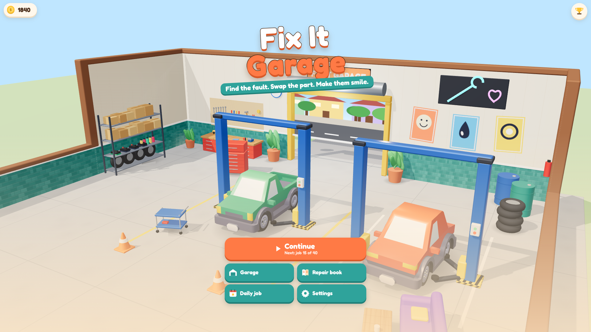
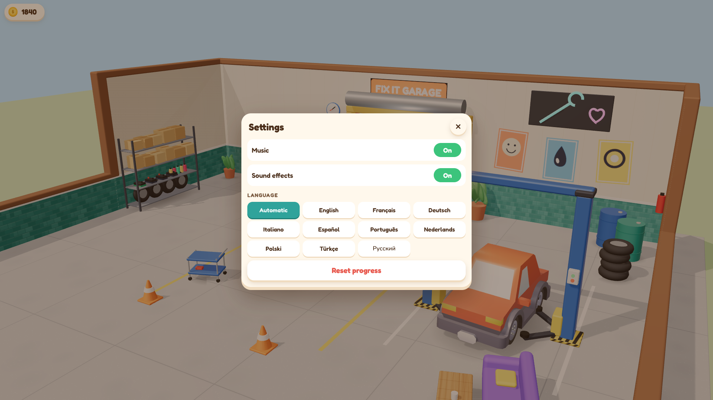
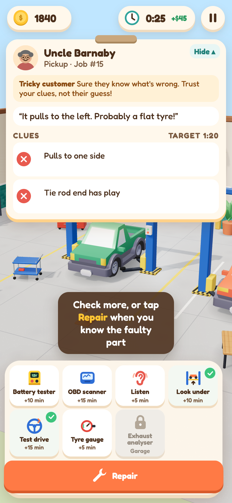
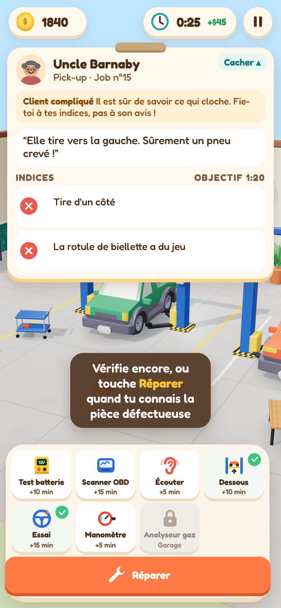
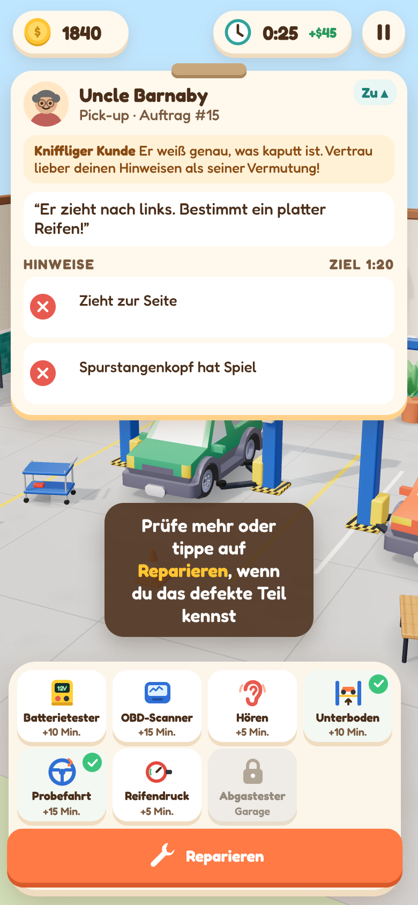
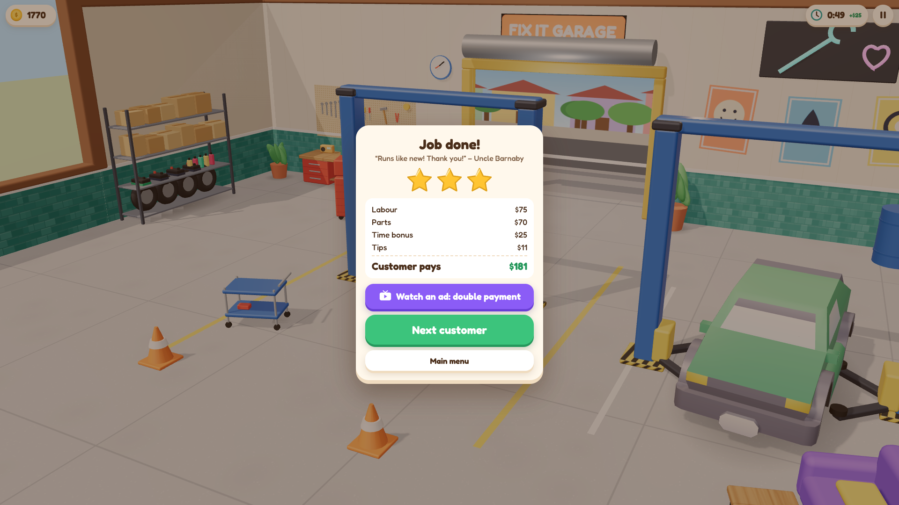

# Phase B screenshots

Captured from real play by `scripts/pr-shots.ts` (software WebGL, nothing staged in an image editor).

| | |
| --- | --- |
|  Main menu over the 3D garage (with bought upgrades: second lift, plants, neon sign, lounge) |  Settings: music, sound effects, the 10 languages, reset progress |

| English | Français | Deutsch |
| --- | --- | --- |
|  |  |  |

The same job (career job 15, a tricky customer who blames a flat tyre; the clues say tie rod) at 390x844.

Payment screen of the GamePix build with the optional "Watch an ad: double payment" button (the web build never shows ad buttons).
