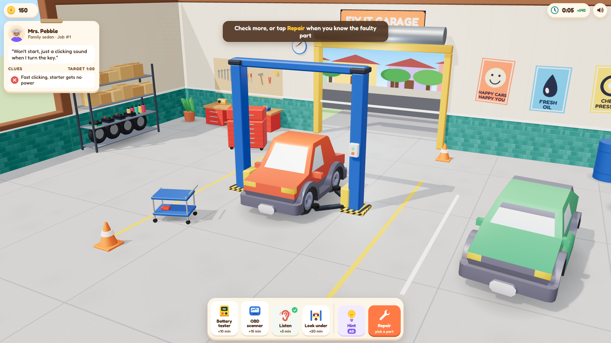
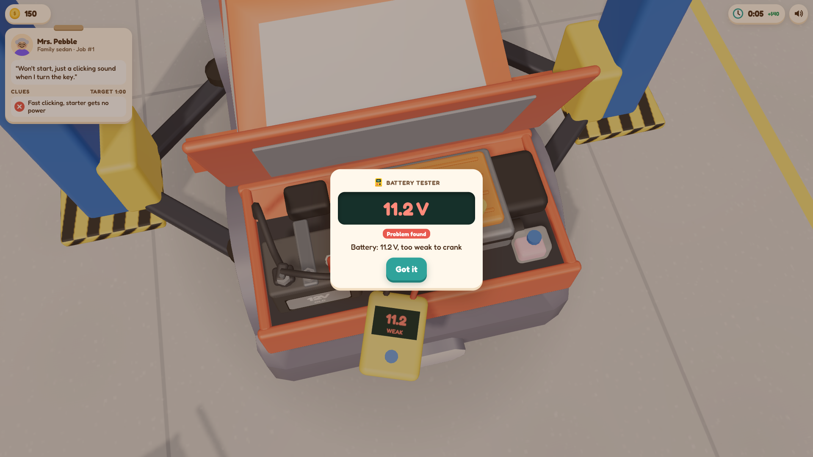
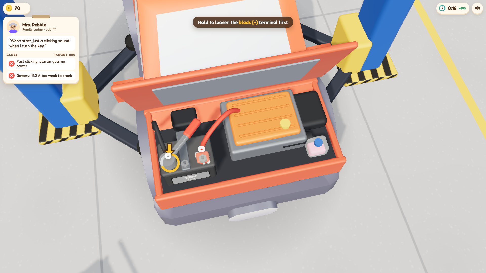
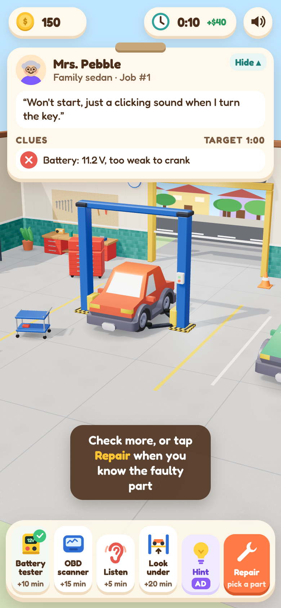
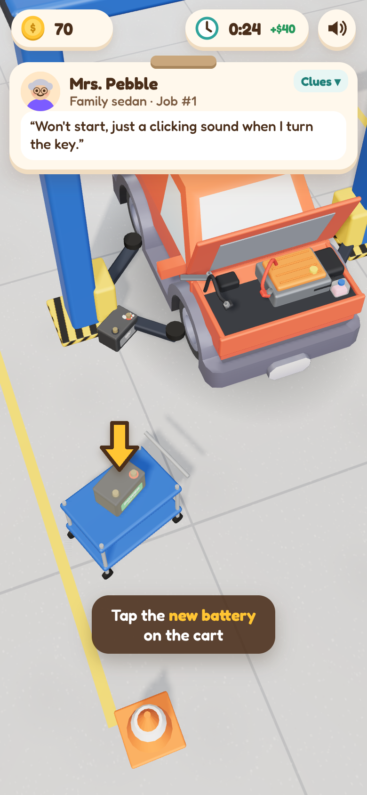
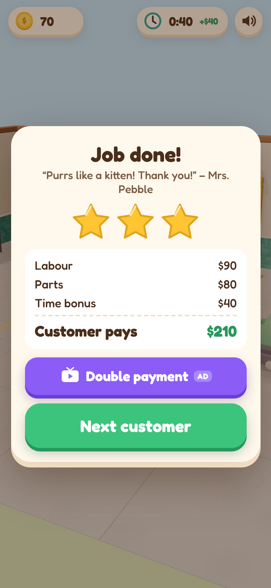

# Phase A preview: art & feel

Play it: **https://rafikaramyan1987-ux.github.io/Fix-It-Garage/** (web build, no ads)

One complete job: a customer's sedan "won't start, just clicking" → diagnose with the battery tester (clip red on +,
black on −, read 11.2 V) → order a battery → swap it (open hood, (−) off first, (+) off, undo clamp, lift the old
battery out, drop the new one in, clamp, (+) on first, (−) on, close hood) → test start → payment with 1–3 stars.
Other tools (OBD scanner, listen, look under on the lift) and wrong parts work too.

| | |
| --- | --- |
|  |  |
|  | |

| | | |
| --- | --- | --- |
|  |  |  |

Video (390x844, ~30 s, the full job played with real taps and holds): [playable-job-390x844.mp4](playable-job-390x844.mp4)

Desktop shots are 1920x1080; phone shots are a 390x844 viewport rendered at 2x (780x1688). All are captured from real
play by `scripts/preview-shots.ts` / `scripts/preview-video.ts` (software WebGL, so no GPU effects are faked).
